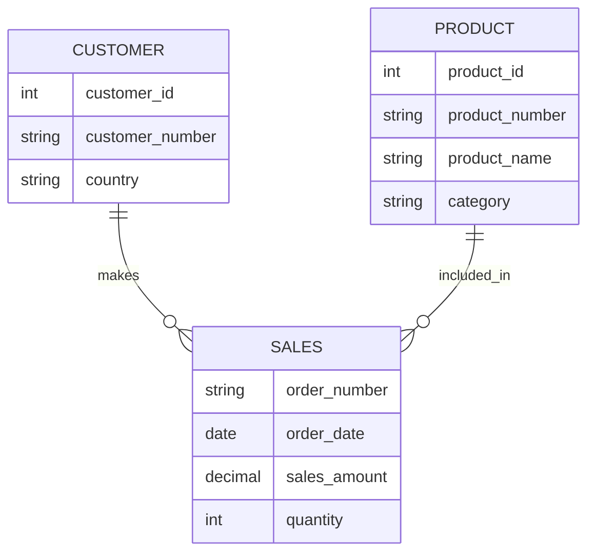

# Data Models

## Purpose

This document explains the project’s conceptual and dimensional model, intended row grain, relationships, keys, and implementation caveats. The model describes analytical intent; it should not be mistaken for enforced constraints where the SQL currently defines views without primary or foreign keys.

## Business entities and relationships

The warehouse integrates three business subjects:

- **Customer**: CRM customer profile enriched by ERP birthdate, gender, and country references.
- **Product**: CRM product definition enriched by ERP category, subcategory, and maintenance metadata.
- **Sales**: CRM transaction records associated with customers and products.

The diagram expresses intended relationships, not physical SQL constraints.

## Dimensional model and grain

### `GOLD.dim_customers`

**Intended grain:** one row per CRM customer business entity after customer duplicate resolution. Attributes include customer ID and number, first/last name, country, marital status, gender, birthdate, and record creation date. Confirm which source is authoritative for each attribute and how conflicting ERP matches are handled.

### `GOLD.dim_products`

**Intended grain:** one row per product, or one row per product version if historical validity is required. Attributes include product ID/number/name, category/subcategory, maintenance, cost, product line, and start date. Since product validity dates are modeled in Silver, decide whether the Gold dimension retains all versions or only a current product record.

### `GOLD.fact_sales`

**Intended grain:** the SQL suggests one row per CRM sales-detail record. Confirm this against the source. `sls_ord_num` may identify an order rather than a unique order line, so the exact natural key must be established before declaring uniqueness or aggregating.

Measures exposed include sales, quantity, and price. Business definitions must specify currency, units, gross/net basis, discount/tax inclusion, returns/cancellations, and rounding/precision.

## Relationships and join logic

The Gold SQL intends to connect:

- fact product business key to product dimension number;
- fact customer ID to customer dimension ID;
- CRM customer key to ERP customer/location references;
- product category key to ERP product category reference.

Validate uniqueness at each right-hand join key. Duplicate reference keys can create join fan-out, duplicating fact rows and increasing measures. Measure unmatched counts and decide whether unmatched rows are rejected, quarantined, retained with null attributes, or assigned an explicit unknown dimension member.

## Physical objects

### Bronze

`BRONZE.crm_cust_info`, `BRONZE.crm_prd_info`, `BRONZE.crm_sales_details`, `BRONZE.erp_CUST_AZ12`, `BRONZE.erp_loc_A101`, `BRONZE.erp_PX_CAT_G1V2`.

### Silver

`SILVER.crm_cust_info`, `SILVER.crm_prd_info`, `SILVER.crm_sales_details`, `SILVER.erp_CUST_AZ12`, `SILVER.erp_loc_A101`, `SILVER.erp_PX_CAT_G1V2`.

### Gold

`GOLD.dim_customers`, `GOLD.dim_products`, and `GOLD.fact_sales` are views in the current Gold DDL.

The current DDL primarily declares nullable columns and does not establish primary-key, unique, or foreign-key constraints. Validation therefore depends on the SQL checks and disciplined key assumptions.

## Key strategy

Source business identifiers include customer IDs/keys, product IDs/keys, order numbers, and ERP identifiers. The Gold views generate product/customer keys with `ROW_NUMBER()`. These are query-time row numbers, not stable persisted warehouse surrogate keys; changes in source rows or ordering can change their values. Do not store them as durable external references.

If durable keys are needed, materialize dimension tables and define key assignment, updates, unknown-member behavior, and historical handling. The current implementation does not provide a complete Type 1/Type 2 slowly changing dimension framework.

## Model assumptions to confirm

- The fact row grain and unique natural key.
- Whether multiple customer/product source versions are expected.
- Product effective-date and history policy.
- Measure definitions, currency and units.
- Required versus optional dimension attributes.
- Whether ERP enrichment is mandatory.
- Treatment of unmatched dimensions and late-arriving references.
- Whether data retention or point-in-time reporting is required.

## Implementation caveats

The model must be aligned with actual executable SQL. Current Silver DDL, transformations, and Gold views have apparent column-name and type mismatches: category fields referenced by transformations/views are not consistently declared, ERP key names differ across definitions, and sales dates are converted but declared as integer in Silver DDL. Correct and test these before relying on the physical model.

## Related documents

- [Architecture](architecture.md)
- [Data integration](data_integration.md)
- [Data catalog](data_catalog.md)
- [Naming conventions](naming_conventions.md)
- [Quality checks](quality_checks.md)
